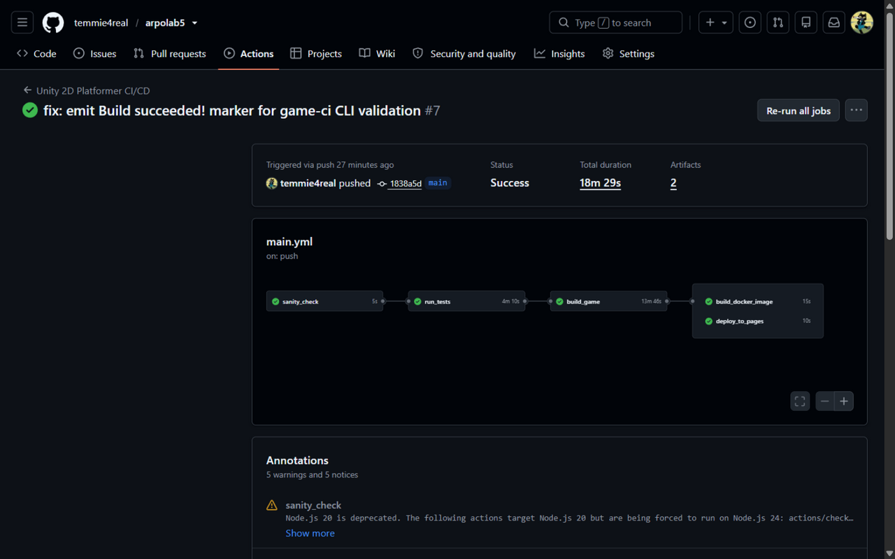
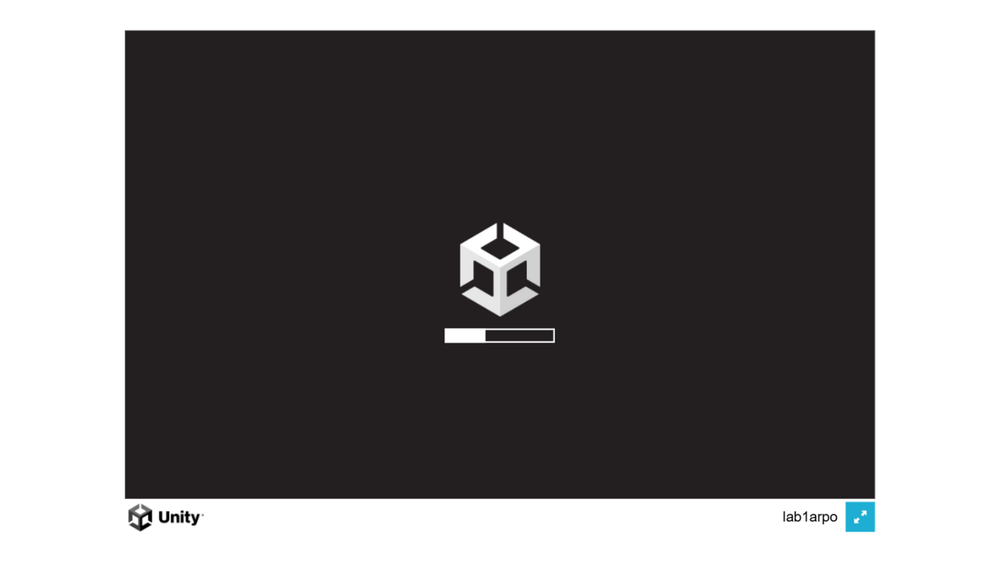
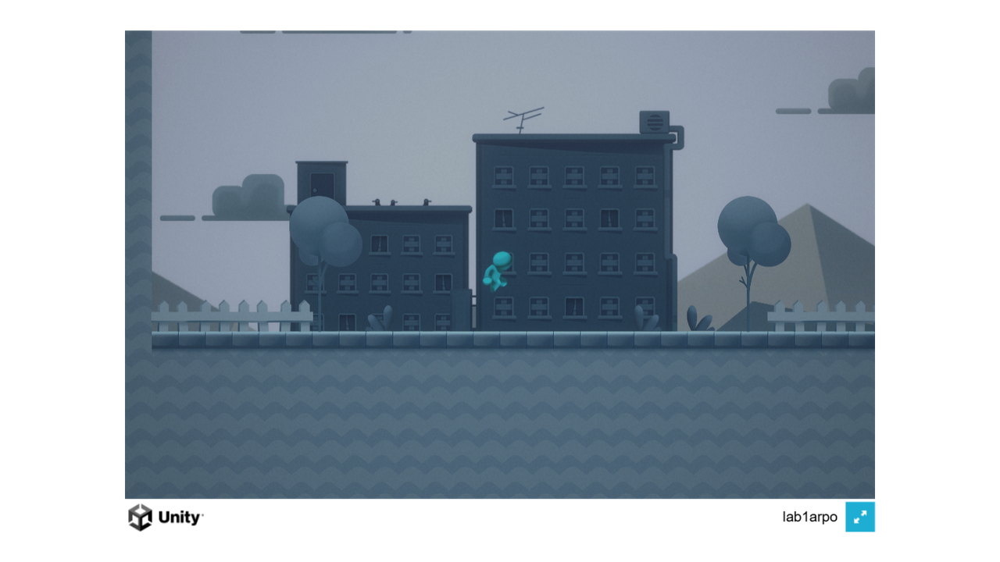
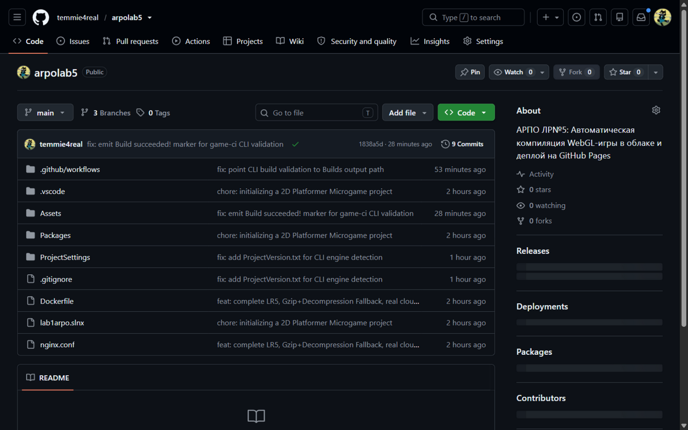

# Лабораторная работа №5. Автоматическая компиляция WebGL-игры в облаке и деплой на GitHub Pages

Студент: Сергей Шнитко

Репозитории:
- https://github.com/temmie4real/arpolab5 (текущий)
- https://github.com/temmie4real/arpolab4 (ЛР №4)
- https://github.com/temmie4real/arpolab3 (ЛР №3)

**Живая игра:** https://temmie4real.github.io/arpolab5/

Цель работы: настроить сквозной пайплайн, который после успешных тестов компилирует реальный WebGL-билд игры в облаке, публикует его на GitHub Pages и собирает Docker-образ с живой игрой вместо файлов-заглушек.

## Ход работы

### Шаг 1: Подготовка Unity 6 к деплою на GitHub Pages

GitHub Pages не умеет отдавать заголовок `Content-Encoding: gzip` для предсжатых файлов, поэтому (в отличие от ЛР №3, где распаковку делает Nginx) включил галочку **Decompression Fallback** — теперь распаковку `.gz` на стороне клиента выполняет встроенный в билд Unity JS-распаковщик.

Фактические значения в `ProjectSettings/ProjectSettings.asset`:

```
webGLCompressionFormat: 1      (Gzip в Unity 6000.3.10f1)
webGLDecompressionFallback: 1  (резервная декомпрессия включена)
```

### Шаг 2: Модернизация облачного пайплайна

Пайплайн вырос до пяти задач, объединенных цепочкой `needs`:

```
sanity_check → run_tests → build_game → build_docker_image
                                     └→ deploy_to_pages
```

- **build_game** — настоящая облачная компиляция: экшен `game-ci/unity-builder` поднимает контейнер с Unity 6, активирует лицензию и вызывает C# метод `BuildManager.BuildWebGL` из ЛР №1 (результат виден пайплайну благодаря `EditorApplication.Exit`). Кэш `Library` (`actions/cache@v4`) ускоряет повторные сборки. Скомпилированные файлы сохраняются артефактом `WebGL-Build` (папка `Builds/WebGL` в git не попадает — она под `.gitignore`).
- **build_docker_image** — теперь вместо генерации фейковых `.gz`-заглушек скачивает живой билд из артефакта (`actions/download-artifact`) и упаковывает настоящую игру в образ `ghcr.io/temmie4real/platformer-game`.
- **deploy_to_pages** — скачивает тот же артефакт и публикует папку `Builds/WebGL` в служебную ветку `gh-pages` (`JamesIves/github-pages-deploy-action@v4`).

### Нюансы, с которыми пришлось столкнуться

Методичка писалась под старую инфраструктуру GameCI — пришлось адаптироваться:

1. **Экшен `unity-builder@v4` требует файл лицензии `.ulf`**, который Unity для Personal-лицензий больше не выдает (ручная активация через `license.unity3d.com/manual` отключена, а локальный файл лицензии Unity 6 привязан к железу). Решение — экшен `unity-builder@v6.0.0`: это обертка над game-ci CLI, который активирует Personal-лицензию по секретам `UNITY_EMAIL` + `UNITY_PASSWORD` (тот же механизм, что и в задаче `run_tests` из ЛР №4).
2. **CLI определяет версию Unity по `ProjectSettings/ProjectVersion.txt`**, поэтому в ЛР №5 этот файл закоммичен (исключен из `.gitignore`), а образ зафиксирован явно: `unityci/editor:ubuntu-6000.3.10f1-webgl-3` — для сборки WebGL нужен образ с модулем WebGL, базового образа (которого хватает тестам) недостаточно.
3. **Валидатор CLI проверяет лог сборки** на наличие строки `Build succeeded!`, но Unity 6 печатает `Build succeeded` без восклицательного знака, а таблицу `# Build results #` в batchmode не печатает вовсе. Добавил вывод точного маркера в `BuildManager.BuildWebGL` после успешной сборки.

### Шаг 3: Отправка и запуск в облаке

После влития PR пайплайн прошел полностью зеленый за 18 минут: `sanity_check` (5 с) → `run_tests` (4 м 10 с) → `build_game` (13 м 46 с — облако качает образ Unity ~2 ГБ, импортирует проект и компилирует игру методом из ЛР №1) → `build_docker_image` (15 с) + `deploy_to_pages` (13 с):



### Шаг 4: Включение GitHub Pages

Задача `deploy_to_pages` публикует билд в ветку `gh-pages`, но сам хостинг включается один раз в настройках репозитория: Settings → Pages → Source: Deploy from a branch → ветка `gh-pages`, папка `/ (root)`. До активации ссылка отдавала 404 даже при зеленом пайплайне — после включения страница собралась, и игра стала доступна по адресу **https://temmie4real.github.io/arpolab5/**.

### Шаг 5: Проверка результатов

1. Все задачи пайплайна зеленые, `build_game` запустился только после успешных `run_tests`, в его логе — строка `[CI/CD] УСПЕХ! WebGL билд успешно создан` (537 с, ~20 МБ) — компиляция выполнена методом `BuildManager.BuildWebGL` из ЛР №1.
2. Артефакт `WebGL-Build` содержит настоящие файлы: `index.html`, `Build/WebGL.framework.js.gz`, `Build/WebGL.wasm.gz`, `Build/WebGL.data.gz` — не заглушки.
3. Ветка `gh-pages` содержит `index.html`, папки `Build`, `StreamingAssets`, `TemplateData`.
4. Игра загружается с GitHub Pages: полоса загрузки доходит до конца (распаковку `.gz` выполняет встроенный JS-распаковщик — Decompression Fallback из Шага 1), персонаж управляется, прыгает:





5. В GHCR обновился образ `ghcr.io/temmie4real/platformer-game:latest` — теперь внутри настоящая игра; локально проверяется командой `docker run -d -p 8080:80 ghcr.io/temmie4real/platformer-game:latest`.

Отчет по лабораторной работе размещен в README основного репозитория:



## Результаты

- Сквозной пайплайн: тесты → облачная компиляция WebGL (реальный билд игры методом из ЛР №1) → Docker-образ с живой игрой → автодеплой на GitHub Pages.
- Игра доступна онлайн: https://temmie4real.github.io/arpolab5/ (GitHub Pages, ветка `gh-pages`).
- Каждый новый push в `main` автоматически пересобирает игру и обновляет и сайт, и Docker-образ.
